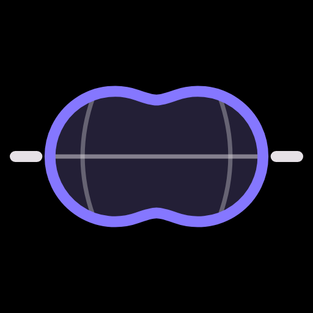
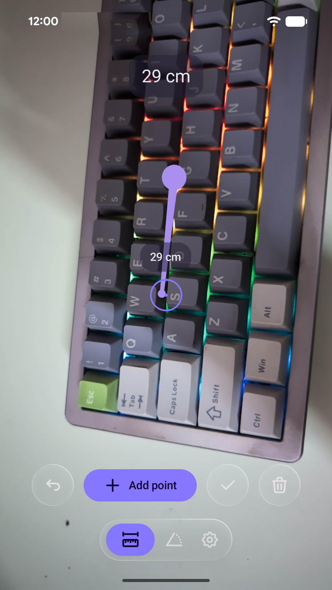
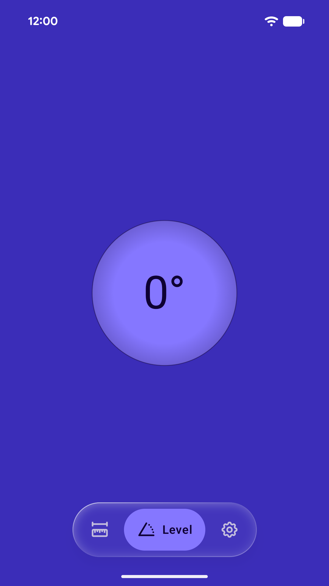
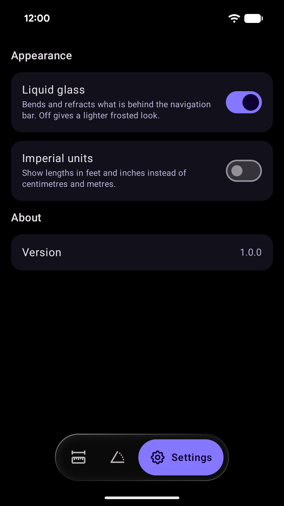

<!--
SPDX-FileCopyrightText: 2026 Saalim Quadri <danascape@gmail.com>
SPDX-License-Identifier: GPL-3.0-or-later
-->

# Measure



Measure lengths in AR and level anything, with a glass bubble level. No ads, no tracking.

<p align="center">
  
  
  
</p>

## Features

- Point your camera at a surface and add points to measure from one spot to the next
- Chain points along a wall or around a table, with each segment and the total
- Undo the last point, finish a line and start another, or clear them all
- Uses depth on supported phones to place points on any surface, not only flat ones
- Centimetres and metres, or feet and inches
- Spirit level: lay the phone flat and two glass spheres merge into one bubble at level, or stand it
  upright for a horizon that stays level with the world
- The tilt in degrees, a screen that floods with colour and a gentle tap at 0°
- Dark and light themes, liquid glass or a lighter frosted look
- Built on [Pvot](https://github.com/PVOT-OSS/PvotLib), the design system behind PVOT-OSS's apps

Measuring in the room needs a phone that supports
[Google Play Services for AR](https://developers.google.com/ar/devices). Measurements are
estimates: move slowly and keep surfaces well lit. The level works on every phone.

## Download

<a href="https://play.google.com/store/apps/details?id=org.prauga.measure"></a>
<a href="https://apps.obtainium.imranr.dev/redirect?r=obtainium://add/https://github.com/PVOT-OSS/PvotMeasure"></a>
<a href="https://github.com/PVOT-OSS/PvotMeasure/releases"></a>

[](https://reports.exodus-privacy.eu.org/en/reports/org.prauga.measure/latest/)

Requires Android 11 or newer.

## Privacy

No accounts, no ads, no analytics. The camera is used only live, to measure; nothing is recorded or
saved. See the [Privacy Policy](PrivacyPolicy.md).

## Building

You need JDK 21 and the Android SDK (`ANDROID_HOME` set). PvotLib comes from its
[Maven repository](https://pvot-oss.github.io/PvotLib/maven), so no account or token is needed.

```sh
./gradlew assembleDebug
```

The APK is written to `app/build/outputs/apk/debug/`.

## Contributing

Bug reports and pull requests are welcome on
[GitHub](https://github.com/PVOT-OSS/PvotMeasure/issues). When reporting a bug, include the steps
to reproduce it, the app version and your device and Android version.

Sign off your commits (`git commit -s`, [DCO](https://developercertificate.org/)). Every file
carries an SPDX header; CI runs [REUSE](https://reuse.software/) and
[pre-commit](https://pre-commit.com/) checks on each pull request. UI changes follow the
[Pvot design system](https://github.com/PVOT-OSS/PvotLib/blob/main/docs/GUIDE.md).

## Credits

- Launcher icon by Shivansh Pandey.
- Measuring maths, unit formatting and the distance board adapted from
  [SceneView](https://github.com/sceneview/sceneview)'s demo app; the AR view uses SceneView's
  `arsceneview` library (Apache-2.0).
- Icons from [Tabler Icons](https://tabler.io/icons) (MIT).

Full details are in [THIRD_PARTY_NOTICES.md](THIRD_PARTY_NOTICES.md).

## License

Copyright (c) Saalim Quadri.

Licensed under the [GNU General Public License v3.0 or later](LICENSE). Code adapted from
SceneView is under the [Apache License 2.0](LICENSES/Apache-2.0.txt); Tabler icons are under the
[MIT License](LICENSES/MIT.txt).

Google Play and the Google Play logo are trademarks of Google LLC.
